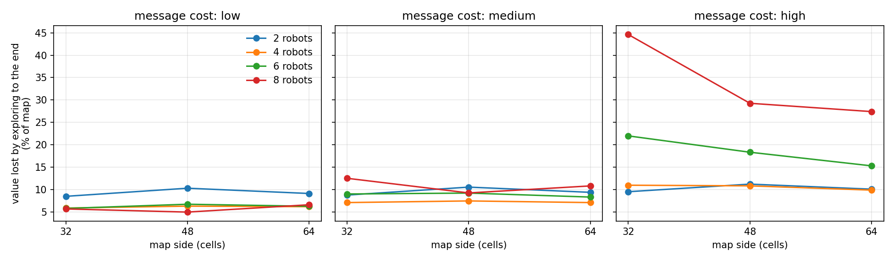
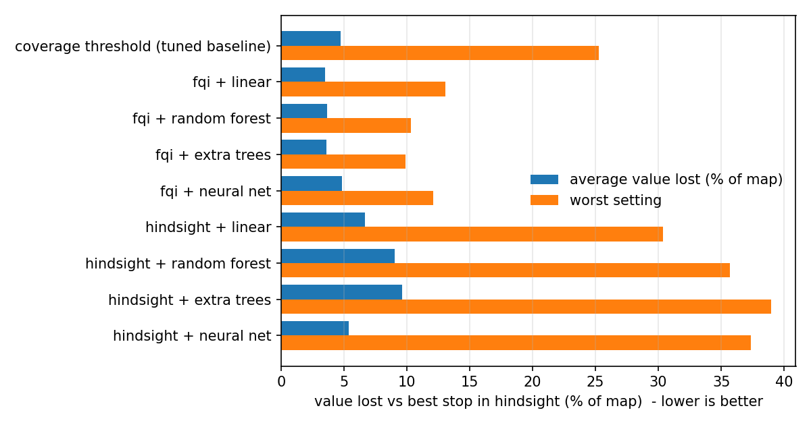

# Value-Aware Adaptive Multi-Robot Exploration

**Question:** a team of robots is mapping an unknown building. Early rounds reveal a lot; late rounds
mean long drives for small leftover corners, which still cost battery and messages.
**How much more exploration is worth paying for, and when should the team stop?**

Study Oriented Project, Dept. of CSIS, BITS Pilani. Chaitanya Goyal, supervised by Prof. Avinash Gautam.

## What's here

| Folder | What it holds |
|---|---|
| `code/` | Simulator, cost model, learned stop rule, all experiments and plots |
| `docs/proposal/` | Current progress-review deck (pptx + pdf), with references |
| `docs/WEEK1_2_RESULTS.md` | Latest results: is the problem real, and is RL needed |
| `docs/Study_Guide_Value_Aware_Stopping.docx` | Explains every slide, formula and metric |
| `docs/literature/` | Paper database and paper comparison sheet |
| `docs/old_versions/` | Earlier decks and notes |
| `tools/` | Scripts that generated the deck and the study guide |
| `ROADMAP.md` | What's done and what's next |

## Run it

```
cd code
pip install -r requirements.txt
python demo.py                  # live demo on a new random map
python week1_problem_size.py    # is the problem real?          (~1 min)
python week2_models.py          # which learning approach works? (~10 min)
python run_experiments.py       # full evaluation of all stop rules
python make_figures.py          # figures in code/figures/
```

All scripts reuse the saved exploration runs in `code/results/`, so nothing has to be re-simulated.

## Results so far

- **The problem is real when costs are high.** Exploring until the map is complete wastes about a third
  of all driving (about 11% of the map's value on average, up to 45%). When driving is cheap, almost nothing
  is wasted, so real cost values are the next step.
- **The RL-style learning target is needed; a big model is not.** Fitted Q-iteration loses at most about
  10% of the map's value across 36 test settings. Learning from hindsight labels loses up to about 39%.
  Even a linear model works.
- **Against the usual "stop at X% mapped" rule:** about equal in normal cases (93% vs 92% of the best
  possible stop), much safer in bad cases (worst setting 9.9% vs 25.3% lost), with no re-tuning.
- **Known weak spot:** 2 robots on large maps sometimes stop too early.



